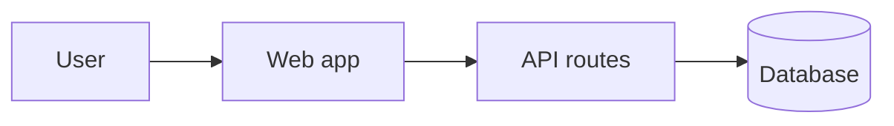

# System Design

## Overview

[One paragraph: how the system works, end to end.]

## Main parts

| Part | What it does | Where it lives |
| --- | --- | --- |
| [Name] | [Its one job] | [`path/in/repo`] |

## Data

| Entity | What it holds | Key fields |
| --- | --- | --- |
| [Name] | [What it represents] | [Fields] |

## Key flows

### [Flow name]

1. [Step]
2. [Step]

## External services

| Service | Used for | Notes |
| --- | --- | --- |
| [Name] | [Purpose] | [Limits, costs, gotchas] |

## Related decisions

- [Link to each decision record that shaped this design]
